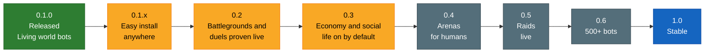

# mod-aware-bots

[](LICENSE)
[-informational)](https://github.com/ProjectSkyfire/SkyFire_548)
[](https://github.com/sardi-dev/mod-aware-bots/releases)
[](tests/)

**Player bots for SkyFire 5.4.8 that play like people, not like pets.**

A few hundred bots with their own plans make a small server feel alive: they quest, fill your dungeon finder queue,
fight battlegrounds with a plan, climb an arena ladder, trade what they earned and remember who was kind to them.
You lead them like players, with marks, roles and party chat, not a page of commands.

| 34 | 47 | 20 | 6 | 1,700+ | ~300 |
|:--:|:--:|:--:|:--:|:--:|:--:|
| specialisations | dungeon strategies | raid strategies | battleground playbooks | unit tests | bots in daily use |

## What we do better

- **They live; you lead.** Bots act on their own plans and follow your marks and roles, no command lists.
- **Nothing is free.** No autogear or cheats: bots pay for repairs and training and wear what they earned.
- **A real market.** Auction house goods were really looted or crafted, and bought with earned gold.
- **Battlegrounds with a plan.** A playbook per map, a leader bot, and call-outs such as `inc bs 3` understood.
- **Manners and memory.** Bots greet, wait for loot, say goodbye, and remember who was kind to them.
- **Skill you can feel.** Expert, good and casual bots, playing class sheets written from player guides.
- **Optional AI orchestrator.** Chat and battleground strategy through OpenRouter, with fallbacks and a budget cap.
- **Built to be trusted.** 1,700+ unit tests, a scenario harness, risky systems off by default.

## Everything the bots do

✅ Ready &nbsp;&nbsp; 🛠️ In development (off by default where marked)

| Area | ✅ Ready | 🛠️ In development |
|------|---------|-------------------|
| World life | Random bots, roaming with purpose, breaks and log-offs, full activity near humans, bot guilds, skill tiers, no cheats or free upkeep, random bot passwords | Travel across continents, city errands, training at trainers, gear upgrades, summons and meeting stones, duel spots, stuck recovery, a higher-level starting batch |
| Groups and dungeons | Goal-based invites, travel to your group, alt bots, dungeon finder fill, finder manners, dungeon chat, a voice per bot | Leading by marks, loot manners, bot-led dungeon runs, bots forming groups in LFG chat, strategies for 47 dungeons |
| Classes and roles | Rotations for all 34 specialisations | Class sheets from player guides, talents and glyphs, tank, healer and damage role sheets, smart dispel timing |
| Raids | | Strategies for 20 raids, every cheat removed |
| Battlegrounds | | Queue fill, 6 map playbooks, a leader bot, call-outs, a human call-out reader; Silvershard Mines, Deepwind Gorge, Tiger's Peak and Temple of Kotmogu rules in the core patches |
| Arenas | | Named 2v2 bot teams with a rating ladder, a ladder NPC, ladder news, a JSON snapshot, team play |
| Duels and PvP | | 1v1 engine, enemy awareness, smart interrupts and defensives, fake casts, burst windows, kill windows, class PvP packages |
| Economy (off) | | Auction selling and buying, mail, a price table from game data, a gold reserve for upkeep, profession materials kept, trial limits, economy tools |
| Social life (off) | | Liking score per human, playstyles, shared-quest group offers, emote replies, privacy and wipe, trial limits |
| AI layer (off) | | Player-to-player chat with human timing, openers, honest "I am a bot" answers, battleground strategy, memory, rule-based fallback, budget cap, privacy filter, admin commands |
| Quality | Unit tests, sidecar and round-trip tests, scenario harness, performance monitor, tagged logs, core gap list, uninstall SQL | |

Details for every feature: [docs/FEATURES.md](docs/FEATURES.md). How we compare with mod-playerbots:
[docs/COMPARISON.md](docs/COMPARISON.md).

## Roadmap



| Stage | What it brings | Status |
|-------|----------------|--------|
| 0.1.x | CI build on upstream SkyFire, a living world config profile, config cleanup, contributing guide | 🟡 In progress |
| 0.2 | Every battleground playbook proven live, Temple of Kotmogu and Deepwind Gorge playbooks, 1v1 round two, PvP packages for every spec | 🟡 In progress |
| 0.3 | Economy and social life on by default, trade chat that names real goods and recipes, bank errands, recipe buying | 🟡 In progress |
| 0.4 | Humans queue against ladder teams, 3v3 and 5v5, crowd control chains, peel and map hazards | ⚪ Planned |
| 0.5 | Raid runs with bot groups led by a human, tank swaps and healer assignments | ⚪ Planned |
| 0.6 | 500 bots and more, with activity scaling and measured limits | ⚪ Planned |
| 1.0 | Stable configuration, checked on more than one server, core hooks upstream | 🔵 Goal |

The AI layer grows along the way, with duel decisions next. Full plan: [docs/ROADMAP.md](docs/ROADMAP.md).

## Quick start

```sh
git clone https://github.com/ProjectSkyfire/SkyFire_548.git && cd SkyFire_548
git checkout -b bots f61bd333aa                     # the base commit in patches/README.md
git clone https://github.com/sardi-dev/mod-aware-bots.git modules/mod-aware-bots-548
git am --keep-cr modules/mod-aware-bots-548/patches/*.patch
cmake -S . -B build -G Ninja -DCMAKE_BUILD_TYPE=RelWithDebInfo -DAWARE_BOTS=ON && cmake --build build
```

Then load `sql/playerbots/` into a `playerbots` database and copy `conf/playerbots.conf.dist` next to
`worldserver.conf`. The full guide is [docs/INSTALL.md](docs/INSTALL.md).

**Good to know:** start with 100 to 300 bots and the [living world profile](docs/INSTALL.md#5-the-living-world-profile);
keep the AI sidecar on a private network (it has no authentication); built and run on Linux.

## Be an early tester

Every 🛠️ feature above gets better with reports from real servers. Install it, let a few hundred bots loose, and tell us
what they did: open an issue with the module's log lines, or a pull request (run `tests/run.sh` first). Your server
shapes 0.2.

## Credits

GPL-2.0-or-later, see [CREDITS.md](CREDITS.md). Built on [mod-playerbots](https://github.com/mod-playerbots/mod-playerbots)
and its [Legends of Azeroth Pandaria 5.4.8](https://github.com/Legends-of-Azeroth/Legends-of-Azeroth-Pandaria-5.4.8)
version, whose authors built the engine this module stands on. No game client data is part of this repository.
